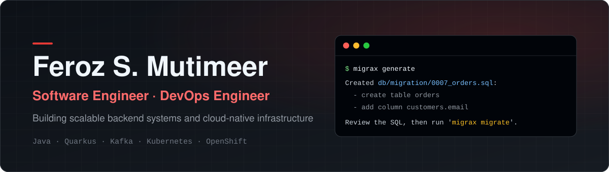

<picture>
  <source media="(prefers-color-scheme: dark)" srcset="assets/banner-dark.svg">
  <source media="(prefers-color-scheme: light)" srcset="assets/banner-light.svg">
  
</picture>

  
  
  
  

  🔨 Building <b>Migrax</b> &nbsp;·&nbsp; ✍️ Writing about schema migrations &nbsp;·&nbsp; 🤝 Open to talks and collaborations

## About me

Backend and DevOps engineer at **IT22 B.V.** (Digital Transformation & Cloud), based in Islamabad.
I design Java microservices and run them on Kubernetes and OpenShift. In my own time I build
**[Migrax](https://github.com/fsmutimeer/migrax)**, an open-source tool that keeps database schemas in
step with the code.

## Tech stack

  
  
  
  
  
  
  
  
  
  
  
  

## Featured project

<table>
  <tr>
    <td width="110" align="center" valign="top">
      
    </td>
    <td valign="top">
      <h3><a href="https://github.com/fsmutimeer/migrax">Migrax</a></h3>
      
Database migrations generated from your JPA and Hibernate entities, with rollback scripts,
      lint checks and verification before they reach production. Works as a CLI, a Maven or
      Gradle plugin, and with Spring Boot, Quarkus, Micronaut, Helidon and Jakarta EE.

      

        
        
        
        
      

      

        <a href="https://migrax.org/"><b>Docs</b></a> &nbsp;·&nbsp;
        <a href="https://migrax.org/download/"><b>Download</b></a> &nbsp;·&nbsp;
        <a href="https://migrax.org/blog/"><b>Blog</b></a> &nbsp;·&nbsp;
        <a href="https://github.com/fsmutimeer/migrax-intellij"><b>IntelliJ plugin</b></a>
      

    </td>
  </tr>
</table>

## Latest articles

<!-- BLOG-POST-LIST:START -->
| Article | Published |
| :-- | --: |
| [Generated SQL migrations for Python, TypeScript and Go projects](https://migrax.org/blog/generated-migrations-for-python-typescript-and-go/) | Oct 31, 2026 |
| [Migrax vs Flyway: generated vs hand-written migrations](https://migrax.org/blog/migrax-vs-flyway/) | Oct 31, 2026 |
| [Catching schema drift before it breaks production](https://migrax.org/blog/catching-schema-drift/) | Oct 31, 2026 |
| [Stop using ddl-auto=update in production](https://migrax.org/blog/stop-using-ddl-auto-update-in-production/) | Oct 31, 2026 |
| [Applying and undoing: migrate, status, rollback](https://migrax.org/blog/applying-and-undoing-migrations/) | Oct 25, 2026 |
<!-- BLOG-POST-LIST:END -->

Updated daily from the <a href="https://migrax.org/blog/">Migrax blog</a>.
